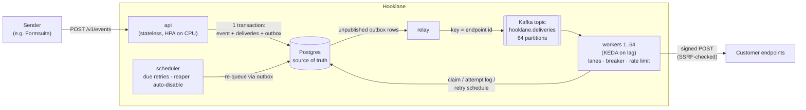

# Hooklane

A self-hosted **outbound webhook delivery service** in Rust. Your application
posts an event once; Hooklane saves it, signs it (Standard Webhooks), and
delivers it to every subscribed customer endpoint with retries, a delivery
log, and protection against slow or failing endpoints. **No event is ever
lost**: once the API answers `202`, the event is in Postgres and will be
delivered or end in a visible `failed`/`dead` state.

Architecture in one breath: a **transactional outbox** in Postgres, a relay
into **Kafka** (Redpanda) with 64 partitions keyed by endpoint, **horizontal
workers** with per-endpoint lanes that **autoscale on consumer lag** (KEDA),
and load and chaos tests whose numbers are measured, not claimed.



## Quickstart

Only Docker is required.

```bash
git clone <this repo> hooklane && cd hooklane
make up      # builds the image and starts everything (first build ~10 min: it compiles librdkafka)
make demo    # tenant + 3 endpoints (healthy, flaky, failing), 100 events, delivery summary
```

## Local dashboards

| What | URL |
|---|---|
| Hooklane API | http://localhost:8080 (`/healthz`, `/readyz`) |
| Grafana, "Hooklane" dashboard | http://localhost:3000 |
| Jaeger (one trace per event: API → relay → worker → HTTP) | http://localhost:16686 |
| Redpanda Console (topic, partitions, consumer lag) | http://localhost:8081 |
| Prometheus (metrics, alert rules) | http://localhost:9090 |
| Sink (fake customer endpoints) stats | http://localhost:8090/_admin/stats |
| Postgres | `localhost:55432` (user/password/db `hooklane`) |

## Makefile targets

| Target | Does |
|---|---|
| `make up` / `make down` / `make logs` | Start (build if needed) / stop and delete volumes / tail logs of the whole stack. `WORKERS=N make up` sets the worker count. |
| `make demo` | Start the stack, create a tenant and endpoints on the sink (healthy, 25% flaky, always failing), send 100 events, print a delivery summary and the dashboard URLs |
| `make test` | Unit tests, then integration tests against real Postgres and Redpanda (started for you) |
| `make test-unit` / `make test-integration` | Just one of the two |
| `make lint` | `cargo fmt --check` and `cargo clippy -D warnings` |
| `make load` | Steady load test (100k events, 100 endpoints) + `loadcheck` report in `docs/results/` |
| `make load-full` | Steady load test at 1M events |
| `make load-spike` | Base rate with a 10× spike; checks consumer lag drains |
| `make chaos-worker` | SIGKILL random workers during a run |
| `make chaos-endpoints` | 30% of endpoints return 5xx, time out, or send 429 |
| `make chaos-db` | Restart Postgres during a run |
| `make load-compare` | The same load in Postgres queue mode and Kafka mode |
| `make load-scale` | Scale workers 4 → 8 → 2 mid-run |
| `make k8s-up` / `make k8s-demo` / `make k8s-down` | kind cluster with KEDA; a burst of events scales workers on lag and back |

`QUEUE_MODE=postgres make up` runs the simpler Postgres-only queue (no relay, no Kafka).

## Results (measured on a laptop)

Apple M1 Pro, Docker in a Colima VM with 6 CPUs / 12 GB; Postgres, Redpanda,
4 workers, the API, the observability stack *and* the k6 load generator all
share that VM. Full reports: [`docs/RESULTS.md`](docs/RESULTS.md) and
[`docs/results/`](docs/results).

| Test (~100k events, 100 endpoints, Kafka mode, 4 workers) | Lost | Duplicates | Delivery p99 | SLO 99% < 60 s |
|---|---:|---:|---:|---|
| Steady, target 2000/s (sustained **1,785 events/s**) | **0** | 0 | 0.56 s | met |
| Spike, 10× for 40 s (peak lag 1,884, drained) | **0** | 0 | 0.68 s | met |
| 3 workers SIGKILLed mid-run | **0** | 17 (expected, explained) | 10.5 s | met |
| 30% of endpoints failing (healthy endpoints only) | **0** | 0 | 0.63 s | met |
| Postgres restarted mid-run | **0** | 0 | 0.41 s | met |
| Postgres vs Kafka queue mode (10k each) | **0 / 0** | 0 / 0 | 75 ms / 46 ms | met |
| Workers scaled 4 → 8 → 2 mid-run (40k) | **0** | 0 | 1.49 s | met |
| kind + KEDA: workers 1 → 11 → 1 on lag (77,634 events) | **0** | – | – | – |

## Development without Docker for the app

Needed only for `make test`, `make lint` and running roles natively:

```bash
brew install rustup cmake && rustup default stable   # Rust + cmake (librdkafka builds with cmake)
brew install kind kubectl                            # for make k8s-*
brew install terraform                               # only to validate deploy/terraform
```

VS Code / Cursor: open the folder and accept the recommended extensions
(rust-analyzer, CodeLLDB, Even Better TOML, Docker). Every Makefile target is a
task (*Run Task*), each role has a debug configuration that runs natively
against the Compose Postgres and Redpanda, and tests have inline Run/Debug
buttons.

## Documentation

| Doc | For |
|---|---|
| [`docs/CODE_TOUR.md`](docs/CODE_TOUR.md) | One event through the code, then one failure through retries to `dead` |
| [`docs/DECISIONS.md`](docs/DECISIONS.md) | Every design decision, the alternatives, and how to explain it |
| [`docs/CONCEPTS.md`](docs/CONCEPTS.md) | Glossary: outbox, consumer lag, circuit breaker, SSRF... |
| [`docs/INTEGRATION.md`](docs/INTEGRATION.md) | Sending events and verifying signatures (TypeScript) |
| [`docs/OBSERVABILITY.md`](docs/OBSERVABILITY.md) | Metrics, traces, logs, SLO, alerts, Datadog |
| [`docs/RESULTS.md`](docs/RESULTS.md) | Load and chaos test results, and what broke |
| [`docs/PROGRESS.md`](docs/PROGRESS.md) | Build log and requirements checklist |

## Guarantees

1. **No lost events.** `202` = committed in Postgres (event, deliveries and outbox in one transaction).
2. **At-least-once delivery, duplicates rare.** Receivers dedupe on `webhook-id`, stable across retries.
3. **No duplicates from internal duplication.** A conditional claim in Postgres (`WHERE status = 'pending'`) lets only one copy of a duplicated message become an HTTP request.
4. **One bad endpoint cannot stall others.** Per-endpoint lanes, 15 s timeout, token bucket, circuit breaker, auto-disable.
5. **Tenant isolation.** Every query is scoped by tenant.
6. **No SSRF.** Private/reserved IPs are refused at connect time (custom DNS resolver) and for literal IPs; no redirects; HTTPS by default.

## Limits and non-goals

- Ordering is **best effort** (like Stripe and Svix): in order on the normal path; retries arrive late.
- Worker parallelism is capped at 64 by the partition count.
- Endpoint edits reach workers within 30 s (endpoint cache).
- In Postgres queue mode, rate limits and breakers are per worker (approximate).
- The kind setup does not export telemetry (no Collector in-cluster); dashboards are demonstrated with Compose.

**Out of scope (future work):** receiving inbound webhooks; a customer portal
or any UI; multiple regions; a strict-ordering option; priority lanes; payload
transformations; billing or usage limits; long-term retention and table
partitioning.

## License

MIT
