# Hooklane

**A self-hosted outbound webhook delivery service, written in Rust.**

Your application posts an event once. Hooklane saves it, signs it, and delivers it over HTTPS to every customer endpoint that subscribed to it, with retries, a full delivery log, and protection against slow or broken endpoints.

The one promise everything else is built around: **once the API answers `202`, the event is never lost.** It is delivered, or it ends in a visible `failed` or `dead` state that you can inspect and replay.

```
Rust · Tokio · axum · PostgreSQL · Kafka (Redpanda) · Kubernetes · KEDA · OpenTelemetry
```

> **Status:** a portfolio project. The architecture is real and the results are measured, but it has only been run on a laptop and a local Kubernetes cluster, never in production. Every number in this README comes from a test that was actually run; see [Results](#results).

---

## Contents

1. [What problem does this solve?](#what-problem-does-this-solve)
2. [Quickstart](#quickstart)
3. [How it works](#how-it-works)
4. [The life of one event](#the-life-of-one-event)
5. [The guarantees, and what enforces each one](#the-guarantees-and-what-enforces-each-one)
6. [The mechanisms, one at a time](#the-mechanisms-one-at-a-time)
   - [Transactional outbox](#1-transactional-outbox-how-an-event-can-never-be-saved-but-not-queued)
   - [Kafka, partitioned by endpoint](#2-kafka-partitioned-by-endpoint)
   - [The conditional claim](#3-the-conditional-claim-how-duplicates-become-harmless)
   - [Per-endpoint lanes](#4-per-endpoint-lanes-no-head-of-line-blocking)
   - [Offset tracking](#5-offset-tracking-never-commit-past-unfinished-work)
   - [Retries](#6-retries-8-attempts-over-28-hours)
   - [Protecting against bad endpoints](#7-protecting-against-bad-endpoints)
   - [Signing](#8-signing-standard-webhooks)
   - [SSRF protection](#9-ssrf-protection)
   - [Autoscaling on lag](#10-autoscaling-on-consumer-lag)
7. [Design decisions](#design-decisions)
8. [Data model](#data-model)
9. [API](#api)
10. [Observability](#observability)
11. [Results](#results)
12. [Running it](#running-it)
13. [Testing](#testing)
14. [Project layout](#project-layout)
15. [Limits and non-goals](#limits-and-non-goals)
16. [FAQ](#faq)

---

## What problem does this solve?

Say you run a form builder. Your customers want to be told when someone submits a form, so they give you a URL and you `POST` to it. That is a webhook. It sounds like one line of code:

```ts
await fetch(customer.webhookUrl, { method: "POST", body: JSON.stringify(event) });
```

It stops being one line as soon as real customers are involved:

| What goes wrong | What you need |
|---|---|
| The customer's server is down for an hour | Retries with backoff, over hours, that survive your own restarts |
| Your process crashes right after saving the submission | A guarantee the webhook still goes out |
| One customer's endpoint takes 15 seconds to answer | Isolation, so it does not slow everyone else down |
| Anyone can POST fake events to the customer's URL | Signatures the customer can verify |
| A customer registers `http://169.254.169.254/` as their URL | Protection against being used to attack your own network |
| The customer asks "did you send it? what did we answer?" | A log of every attempt |
| Traffic grows 10× on a Monday morning | Workers that scale out automatically |

Hooklane is that whole second column as a service. The sender makes one HTTP call (`POST /v1/events`) and forgets about it.

---

## Quickstart

You need Docker and nothing else.

```bash
git clone https://github.com/BradyEdgar94/hooklane.git && cd hooklane
make demo
```

`make demo` builds the image (about 10 minutes the first time, because it compiles the Kafka client library; about a minute after that), starts the whole system, creates three fake customer endpoints (one healthy, one that fails 25% of the time, one that always fails), sends 100 events, and prints what happened:

```
     endpoint     | succeeded | retrying | failed | dead | pct_delivered | max_attempts | next_retry_in
------------------+-----------+----------+--------+------+---------------+--------------+---------------
 healthy          |       100 |        0 |      0 |    0 |         100.0 |            1 |
 flaky (25% 500s) |        90 |       10 |      0 |    0 |          90.0 |            2 | 04:01
 always failing   |         0 |      100 |      0 |    0 |           0.0 |            1 | 00:10

{"unique_ids":100,"requests":100,"ok_requests":100,"duplicate_ok":0,"bad_signatures":0}   <- healthy
{"unique_ids":100,"requests":130,"ok_requests":90,"duplicate_ok":0,"bad_signatures":0}    <- flaky
{"unique_ids":5,"requests":5,"ok_requests":0,"duplicate_ok":0,"bad_signatures":0}         <- failing
```

How to read that:

- **Healthy:** all 100 delivered on the first try, each exactly once, every signature valid.
- **Flaky:** 90 delivered so far. The other 10 failed twice and are waiting for their third attempt in 4 minutes. That is the retry schedule working.
- **Always failing:** it was only called **5 times**, not 100. After 5 failures in a row its circuit breaker opened, and the other 95 deliveries were set aside instead of hammering a server that is down.

Then open the dashboards:

| What | URL | What it tells you |
|---|---|---|
| Grafana | http://localhost:3000 | Is the system healthy? Rates, latency, lag, open breakers |
| Jaeger | http://localhost:16686 | What happened to one event, step by step, with timings |
| Redpanda Console | http://localhost:8081 | What is inside Kafka: the topic, 64 partitions, consumer lag |
| Prometheus | http://localhost:9090 | Raw metrics and alert rules |
| API | http://localhost:8080 | The permanent record: events, deliveries, attempts |

`make down` stops everything and deletes its data.

---

## How it works

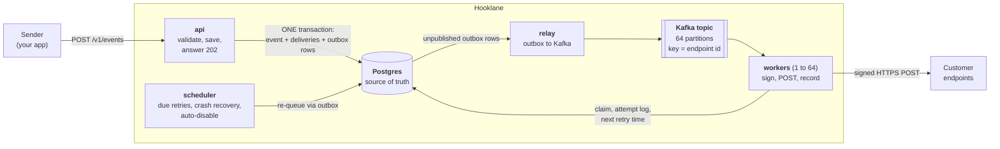

Three ideas carry the design:

1. **Postgres is the source of truth.** Every event, delivery and attempt lives there. Kafka is only the conveyor belt that hands work to workers; if Kafka lost everything, the system could rebuild it from Postgres.
2. **Only the relay writes to Kafka**, and it only publishes what is already committed in Postgres. New deliveries and retries take the same path.
3. **Messages are keyed by endpoint.** All deliveries for one customer endpoint land in one Kafka partition, and one partition is owned by exactly one worker at a time. That single fact makes ordering, rate limiting and circuit breaking simple.

### One binary, four roles

There is one program, `hooklane`, and one Docker image. Each process runs one role:

| Role | What it does | How it scales |
|---|---|---|
| `api` | Authenticates, validates, writes the event in one transaction, answers `202`. Also serves endpoint management and the delivery log. | Stateless. Many replicas behind a load balancer, autoscaled on CPU. |
| `relay` | Copies unpublished outbox rows into Kafka. | 1 or 2 replicas. |
| `scheduler` | Re-queues retries that are due, recovers deliveries from crashed workers, disables endpoints that have failed for days. | 1 or 2 replicas. |
| `worker` | Consumes Kafka, protects endpoints, signs, POSTs, records the result. | 1 to 64 replicas, autoscaled on Kafka consumer lag. |

```bash
hooklane --role api | relay | scheduler | worker
hooklane migrate                                # run migrations, create the Kafka topic
hooklane admin create-tenant --name acme        # prints an API key, shown once
```

Why one binary: every role ships together, so versions can never drift apart, and Kubernetes just runs the same image with a different argument.

---

## The life of one event

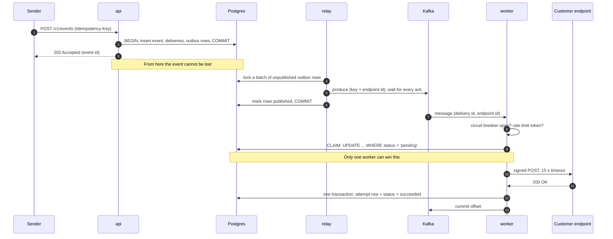

If step 10 returns a `500` instead, step 11 writes `status = retry_scheduled` and a `next_attempt_at` time. Later the scheduler notices the time has come, flips the delivery back to `pending`, and writes a new outbox row, and the event travels the same path again from step 4.

A file-by-file walk through this, with the exact functions, is in [docs/CODE_TOUR.md](docs/CODE_TOUR.md).

---

## The guarantees, and what enforces each one

A guarantee only means something if you can point to the line of code or the database constraint that enforces it.

| # | Guarantee | Enforced by |
|---|---|---|
| 1 | **No lost events.** `202` means stored. | The event, its deliveries and its outbox rows are written in **one Postgres transaction**. The API answers only after `COMMIT`. |
| 2 | **At-least-once delivery.** A crash may cause a repeat send, never a missed one. | Kafka offsets are committed only after work finishes. A scheduler job ("the reaper") re-queues any delivery stuck in `delivering` for 2 minutes. |
| 3 | **Internal duplicates never reach the customer.** A duplicated Kafka message or two workers seeing the same delivery produce at most one HTTP request per attempt. | The **conditional claim**: `UPDATE deliveries SET status='delivering' WHERE id=$1 AND status='pending'`. Only one process gets a row back. |
| 4 | **One bad endpoint cannot stall the others.** | Per-endpoint lanes, a 15 s timeout, a token-bucket rate limit, a circuit breaker, and auto-disable. |
| 5 | **Tenant isolation.** | Every API query includes `tenant_id` in its `WHERE` clause. A handler cannot obtain a tenant id except through authentication. |
| 6 | **Cannot be used to reach private networks.** | The IP address is checked **at connection time**, after DNS resolution, against every private and reserved range. Redirects are never followed. |

All six are covered by integration tests that run against a real Postgres and a real Kafka broker.

---

## The mechanisms, one at a time

Each section says what the mechanism is, why it exists, and what would go wrong without it.

### 1. Transactional outbox: how an event can never be "saved but not queued"

**The problem (the "dual-write problem").** The obvious design is: save the event to the database, then publish it to the queue. Those are two separate systems and there is no transaction that covers both. If the process dies between the two steps, you have an event that is saved but will never be delivered, and nothing notices.

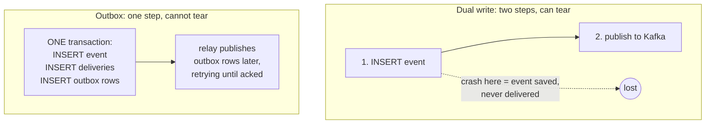

**The fix.** Write a row that says "this needs publishing" into an `outbox` table, in the same transaction as the event itself. Either all of it commits or none of it does. A separate process, the relay, reads unpublished rows, publishes them to Kafka, waits for Kafka's acknowledgement, and only then marks them published.

**What if the relay crashes?** If it dies after Kafka accepted a message but before marking the row, it publishes the row again on restart. That creates a duplicate message, never a missing one, and the duplicate is harmless because of [the claim](#3-the-conditional-claim-how-duplicates-become-harmless).

Code: [`db/events.rs`](crates/hooklane/src/db/events.rs), [`relay.rs`](crates/hooklane/src/relay.rs)

### 2. Kafka, partitioned by endpoint

A Kafka topic is split into **partitions**, which are independent ordered logs. Each message has a **key**, and Kafka hashes the key to choose the partition. Hooklane's topic has 64 partitions and the key is the endpoint id.

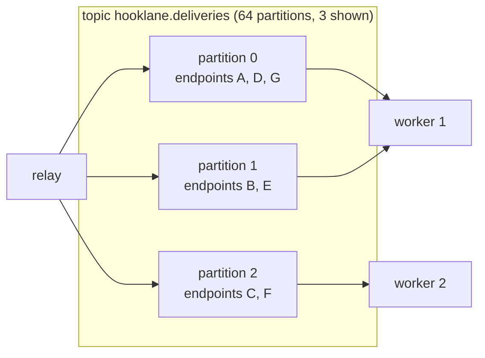

Two consequences:

- **All deliveries for one endpoint are in one partition, in order.**
- **A partition is consumed by exactly one worker at a time.** So at any moment, exactly one worker is talking to a given endpoint.

That second point is why rate limits and circuit breakers can be plain in-memory structs with no Redis: the worker that owns the endpoint is the only one calling it, so its local view is the whole truth.

**Why 64, chosen up front?** The partition count is the ceiling on worker parallelism (one consumer per partition). Adding partitions later changes which partition each endpoint hashes to, which would break ordering during the change. So it is set generously at the start.

**Why Redpanda?** It speaks the Kafka protocol and runs as a single small container, which suits a laptop. The same client code works unchanged against Apache Kafka or a managed service.

### 3. The conditional claim: how duplicates become harmless

Kafka delivers messages **at least once**. A relay retry, a rebalance, or a crash can hand the same delivery to a worker twice, or to two different workers. Hooklane does not try to prevent that. It makes it not matter.

Immediately before sending, the worker runs:

```sql
UPDATE deliveries
   SET status = 'delivering', claimed_at = now(), attempt_count = attempt_count + 1
 WHERE id = $1 AND status = 'pending'      -- the condition is the whole trick
RETURNING ...;
```

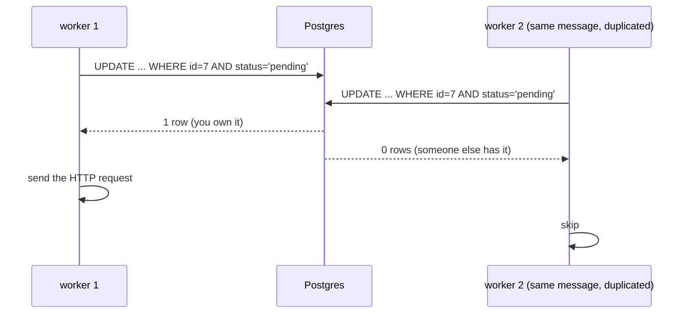

Postgres runs the two updates one after the other. The first changes the status, so the second finds no row matching `status = 'pending'` and gets nothing back. Whoever gets a row sends; everyone else skips.

The same pattern is used for **every** status change in the system: each is written as `UPDATE ... WHERE status = '<what I expect>'`, and the code checks how many rows changed. Races between a slow worker and the crash-recovery job, or between two schedulers, resolve the same way, with no locks held across network calls.

Code: [`db/deliveries.rs`](crates/hooklane/src/db/deliveries.rs)

### 4. Per-endpoint lanes: no head-of-line blocking

Many endpoints share one partition. If a worker processed a partition strictly one message at a time, one endpoint that takes 15 seconds to time out would delay every endpoint queued behind it. That is **head-of-line blocking**.

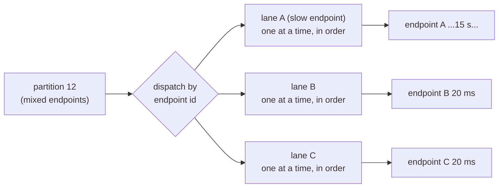

Each endpoint gets its own in-memory queue and task, a **lane**. Different endpoints run in parallel. Each endpoint's own deliveries run one at a time, which keeps them in order. A slow endpoint only slows itself.

Two safety valves:

- **Backpressure.** If a partition has 256 unfinished messages, the worker pauses fetching from it until it drains to half that. Memory use stays bounded.
- **Lane overflow.** If one endpoint's lane holds more than 100 messages, the excess is put back into Postgres to retry a few seconds later, without using up an attempt. Otherwise one slow endpoint could fill the partition's 256 slots and block its neighbours after all.

`PER_ENDPOINT_CONCURRENCY` (default 1) raises the per-endpoint parallelism at the cost of ordering.

Code: [`worker/lanes.rs`](crates/hooklane/src/worker/lanes.rs), [`worker/kafka_loop.rs`](crates/hooklane/src/worker/kafka_loop.rs)

### 5. Offset tracking: never commit past unfinished work

Kafka remembers a consumer's progress as one number per partition, the **committed offset**, meaning "everything before this is done". But lanes finish messages out of order: offset 7 (fast endpoint) can finish before offset 5 (slow endpoint).

```
offsets:    5      6      7      8      9
status:   [busy] [done] [done] [done] [busy]
                                              safe to commit: 5
            ^ the first unfinished message. Committing 9 here and then
              crashing would mean offset 5 is never delivered again.
```

So the worker tracks which offsets are in flight and only ever commits up to the first unfinished one. After a crash, everything from that point is redelivered. Some of it was already sent, and the claim skips those.

Code: [`worker/offsets.rs`](crates/hooklane/src/worker/offsets.rs)

### 6. Retries: 8 attempts over 28 hours

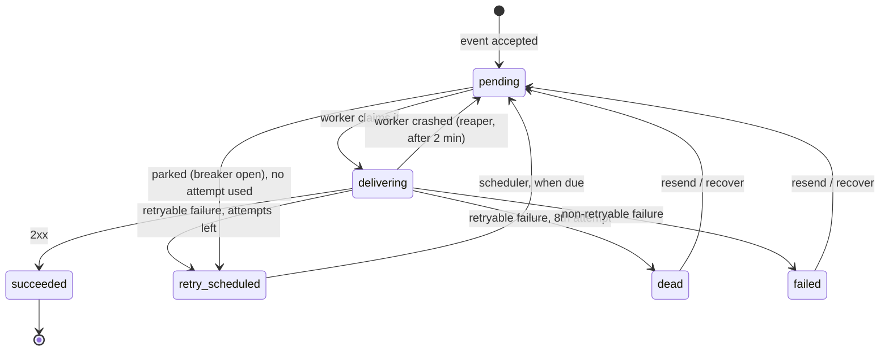

**The schedule.** Attempt 1 is immediate. The waits before attempts 2 to 8 are:

```
5 s    5 min    30 min    2 h    5 h    10 h    10 h         total: about 28 hours
```

Each wait has ±20% random **jitter**. Without it, a thousand deliveries that failed in the same second would all retry in the same second and knock the recovering server over again.

**What counts as retryable:**

| Customer's response | What Hooklane does |
|---|---|
| `2xx` | Done: `succeeded` |
| Timeout, connection error, TLS error, `5xx`, `408` | Retry |
| `429` | Retry, and honour `Retry-After` (clamped to between 1 second and 6 hours) |
| `410 Gone` | `failed`, and **disable the endpoint**: the customer has told us to stop |
| Any other `4xx` | `failed`: a bad request will not fix itself |
| `3xx` | `failed`: redirects are never followed |

After the 8th failure the delivery becomes **`dead`**. Nothing is deleted. A `hooklane.delivery.dead` event is sent to any endpoint that subscribed to it, and `POST /v1/deliveries/{id}/resend` or `POST /v1/endpoints/{id}/recover` brings deliveries back.

**Why the retry time lives in Postgres and not in Kafka.** Kafka has no way to say "deliver this in 30 minutes". Storing a `next_attempt_at` column gives exact delays, honours a customer's `Retry-After`, survives crashes, and lets the API show when the next attempt is due.

Code: [`delivery/retry.rs`](crates/hooklane/src/delivery/retry.rs), [`scheduler.rs`](crates/hooklane/src/scheduler.rs)

### 7. Protecting against bad endpoints

One customer's broken server must not degrade service for everyone else (the "noisy neighbour" problem). There are four layers:

| Layer | What it does |
|---|---|
| **Timeout** | 15 seconds per attempt, total. |
| **Rate limit** | A token bucket per endpoint, 50 requests/second by default, configurable per endpoint. Protects small servers from bursts. |
| **Circuit breaker** | Stops calling an endpoint that is clearly down. |
| **Auto-disable** | An endpoint that has failed continuously for 5 days is disabled and its owner is notified. |

The circuit breaker has three states:

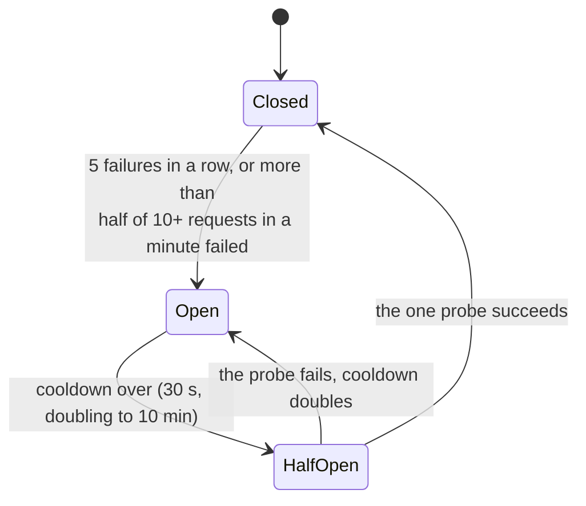

- **Closed:** normal. Requests flow.
- **Open:** the endpoint is not called at all. Its deliveries are **parked**: put back in Postgres to retry at the next probe time, **without using up an attempt**, because the endpoint never got a chance to answer.
- **Half-open:** after the cooldown, exactly one delivery is let through as a probe. If it succeeds, the breaker closes.

The demo shows this directly: the always-failing endpoint received 5 requests, not 100.

Only timeouts, connection errors and `5xx` count as failures. A `429` means "slow down", not "I am down", and a `404` means the endpoint is up but misconfigured.

Code: [`delivery/breaker.rs`](crates/hooklane/src/delivery/breaker.rs), [`delivery/ratelimit.rs`](crates/hooklane/src/delivery/ratelimit.rs)

### 8. Signing (Standard Webhooks)

A webhook URL is public. Without a signature, anyone who learns it can POST fake events to the customer.

Hooklane implements the [Standard Webhooks](https://www.standardwebhooks.com/) specification exactly, so customers can verify with an off-the-shelf library in any language. Every request carries:

```http
webhook-id: 01a1fbed-2a73-70d3-8943-03a6c924392d     the event id, identical on every retry
webhook-timestamp: 1795231264                         when this attempt was sent
webhook-signature: v1,g0hM9SsE+OTPJTGt/tmIKtSyZlE3uFJELVlNIOLJ1OE=
webhook-sequence: 4812                                increases per endpoint
webhook-attempt: 1
```

The signature is `HMAC-SHA256(secret, "{id}.{timestamp}.{body}")`. Each part is there for a reason:

- **The body:** it cannot be altered in transit.
- **The timestamp:** receivers reject anything more than 5 minutes old, so a captured request cannot be replayed later.
- **The id:** receivers can spot and skip a duplicate.

**Secret rotation without downtime.** `POST /v1/endpoints/{id}/rotate-secret` creates a new secret and keeps the old one valid for 24 hours. During that window every request carries **two** signatures, so the customer can switch whenever they like.

The test suite verifies Hooklane's signatures with the official `standardwebhooks` library (Rust and npm), and checks that a tampered body, a wrong secret and a stale timestamp are all rejected.

Code: [`delivery/signing.rs`](crates/hooklane/src/delivery/signing.rs) · Receiver example: [`examples/typescript/verify.ts`](examples/typescript/verify.ts)

### 9. SSRF protection

Customers choose the URL that Hooklane's workers will call. An attacker could register `http://169.254.169.254/latest/meta-data/` (the cloud metadata service, which hands out credentials), or `http://localhost:5432`, and have a worker make that request from **inside** the network. This is server-side request forgery, and a webhook service is exposed to it by design.

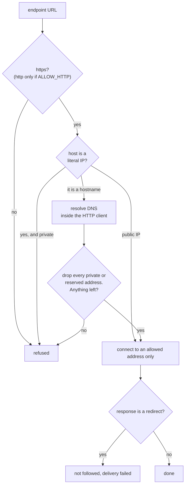

The important design point is **where** the check happens. Checking the URL when the endpoint is created is not enough, because of **DNS rebinding**: `evil.example.com` can resolve to a public address during validation and to `10.0.0.5` an hour later when the delivery is sent. So the decisive check runs **at connection time, on the exact IP addresses about to be connected to**, through a custom DNS resolver plugged into the HTTP client.

Also enforced: URLs with a literal IP (which skip DNS) are checked separately, redirects are never followed (a public URL could redirect inward), no proxy is used, and IPv4 addresses hidden inside IPv6 (`::ffff:127.0.0.1`, NAT64) are unwrapped before checking.

Code: [`delivery/ssrf.rs`](crates/hooklane/src/delivery/ssrf.rs)

### 10. Autoscaling on consumer lag

**Consumer lag** is the number of messages written to Kafka that workers have not yet finished. It is the most direct measure of "are we falling behind?"

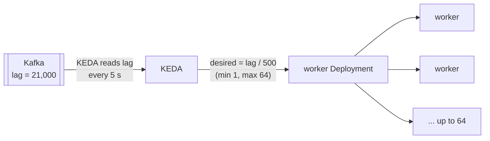

- **Workers** scale on lag with [KEDA](https://keda.sh/). CPU would be the wrong signal: a worker waiting on slow endpoints uses almost no CPU while falling far behind.
- **The API** scales on CPU with a standard HorizontalPodAutoscaler, which suits a stateless request handler.

When workers are added or removed, Kafka rebalances partitions between them. Every role handles `SIGTERM` by finishing in-flight work and committing offsets before exiting, so scaling down drops nothing.

Measured on a local Kubernetes cluster during a 3,000 events/second burst:

```
  t=  0s  workers= 1   lag=    15
  t=  5s  workers= 3   lag=  5193
  t= 22s  workers= 7   lag= 19883
  t= 38s  workers=11   lag= 14892
  t= 60s  workers=11   lag=     0      burst over, lag drained
  t= 65s  workers= 5   lag=     0
  t= 97s  workers= 1   lag=     0      all 77,634 events delivered
```

Manifests: [`deploy/k8s/`](deploy/k8s)

---

## Design decisions

The short version. Each one, with the alternatives and the full reasoning, is in [docs/DECISIONS.md](docs/DECISIONS.md).

| Decision | Chosen | Rejected | Why |
|---|---|---|---|
| Language | **Rust** | Go, TypeScript, Python | The compiler rejects data races, unhandled errors and null dereferences before the code runs. Proven for this job by Svix. |
| Queue | **Postgres outbox + Kafka** | Postgres only, Redis, SQS | The outbox removes the dual-write problem. Kafka spreads load and gives each endpoint a single owner. |
| Retries | **8 attempts over ~28 h, times stored in Postgres** | Kafka retry topics | Exact delays, honours `Retry-After`, survives crashes, visible in the API. |
| Bad endpoints | **Timeout, token bucket, circuit breaker, auto-disable, state in worker memory** | Shared state in Redis | One worker owns each endpoint, so there is nothing to coordinate. |
| Ordering | **Best effort**, with a timestamp and sequence number | Strict ordering | With strict ordering one failing event blocks an endpoint for 28 hours. Stripe and Svix make the same choice. |
| Security | **Standard Webhooks, in-process SSRF checks, hashed keys, encrypted secrets** | A separate egress proxy | Spec-compliant, and one less service to run. |
| Deployment | **One binary, four roles** | Four separate services | Versions cannot drift, and each role scales on its own signal. |
| Observability | **OpenTelemetry** | Vendor SDKs | Instrument once, send anywhere, including Datadog. |

Two of these deserve a little more:

**Why not just use Postgres as the queue?** You can, and Hooklane ships that mode (`QUEUE_MODE=postgres`) so the two can be compared. Workers claim rows directly with `FOR UPDATE SKIP LOCKED`. It is simpler and, at small scale, slightly faster at the median. Its limits are that every poll is a write on the busiest table, and that several workers can serve the same endpoint, so rate limits and breakers are only per-worker. The demo shows this: in Postgres mode with two workers, the failing endpoint got 10 attempts before parking (5 per worker). In Kafka mode it got exactly 5.

**Why best-effort ordering?** On the normal path an endpoint receives its events in order. But if event 5 fails and has to retry in 5 minutes, should events 6, 7 and 8 wait behind it? Strict ordering says yes, which means one bad event can block a customer for 28 hours. Hooklane delivers 6, 7 and 8, and gives receivers a timestamp and a sequence number to detect a late arrival.

---

## Data model

Seven tables. The unique constraints are part of the guarantees, not decoration.

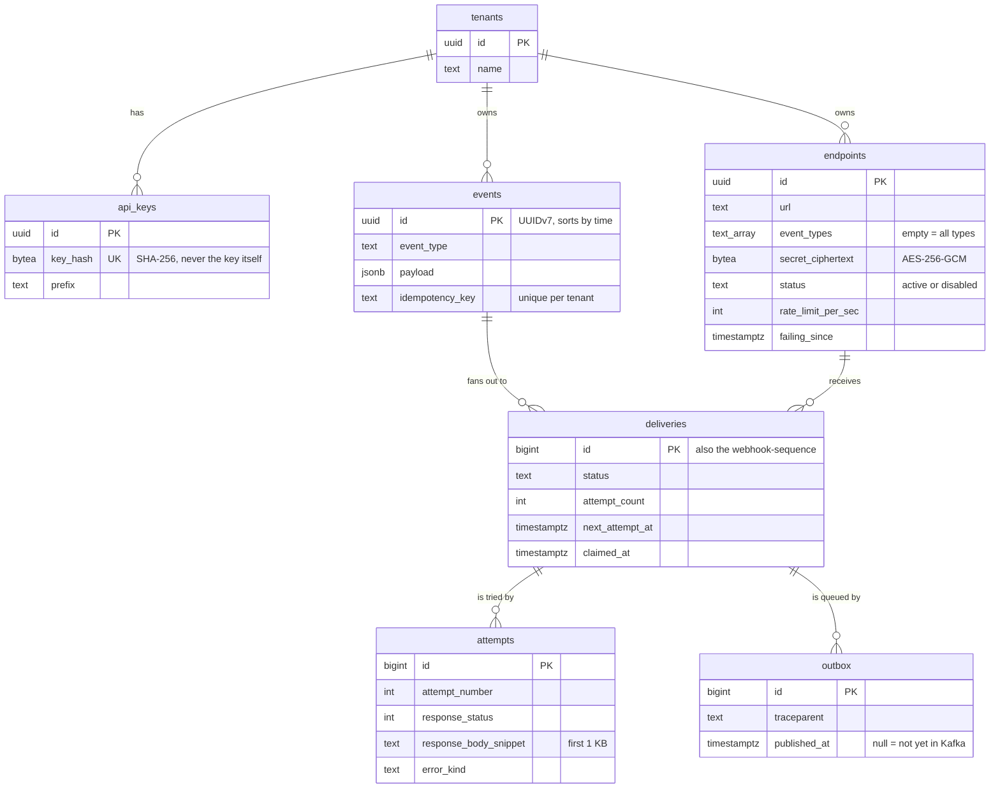

| Constraint | What it guarantees |
|---|---|
| `events (tenant_id, idempotency_key)` unique | A retried `POST /v1/events` with the same key cannot create a second event, even when two requests race. |
| `deliveries (event_id, endpoint_id)` unique | An event can never be fanned out twice to the same endpoint. |
| Partial indexes on `pending`, `retry_scheduled`, `delivering`, unpublished outbox | "Find work" queries stay fast no matter how many finished rows pile up, because finished rows are not in the index. |

Migration: [`migrations/`](migrations)

---

## API

Everything is under `/v1`, authenticated with `Authorization: Bearer <api key>`, JSON in and out. Errors look like `{"error": {"code": "...", "message": "..."}}`.

**Send an event**

```bash
curl -X POST http://localhost:8080/v1/events \
  -H "Authorization: Bearer $KEY" -H "Content-Type: application/json" \
  -H "Idempotency-Key: form.submitted:sub_123" \
  -d '{"type": "form.submitted", "data": {"form": "contact", "email": "ada@example.com"}}'
# 202 {"id": "01a1fc3f-...", "duplicate": false}
```

Sending the same `Idempotency-Key` again returns the original id with `"duplicate": true` and creates nothing.

**Register a customer endpoint**

```bash
curl -X POST http://localhost:8080/v1/endpoints \
  -H "Authorization: Bearer $KEY" -H "Content-Type: application/json" \
  -d '{"url": "https://customer.example.com/hooks", "event_types": ["form.submitted"]}'
# 201 {"id": "...", "secret": "whsec_...", ...}     the secret is what the customer verifies with
```

**All routes**

| Route | Purpose |
|---|---|
| `POST /v1/events` | Ingest. Returns `202`. |
| `GET /v1/events`, `GET /v1/events/{id}` | Event log; one event with its deliveries. |
| `POST /v1/endpoints`, `GET /v1/endpoints`, `GET/PATCH/DELETE /v1/endpoints/{id}` | Endpoint management. `PATCH {"status":"active"}` re-enables. |
| `GET /v1/endpoints/{id}/secret` | Fetch the signing secret. |
| `POST /v1/endpoints/{id}/rotate-secret` | New secret; old one valid for 24 h. |
| `POST /v1/endpoints/{id}/recover` | Re-queue `failed` and `dead` deliveries since a timestamp. |
| `GET /v1/deliveries?endpoint_id=&event_id=&status=` | Delivery log. |
| `GET /v1/deliveries/{id}` | One delivery with every attempt: status code, duration, first 1 KB of the response. |
| `POST /v1/deliveries/{id}/resend` | Start a fresh retry cycle. |
| `GET /healthz`, `GET /readyz` | Process up; database reachable. |

List routes use **cursor pagination** (`?cursor=&limit=`, response includes `next_cursor`), not `OFFSET`. `OFFSET` gets slower the deeper you page and skips or repeats rows when data changes underneath you; a cursor does neither.

Full guide, including a TypeScript sender and receiver: [docs/INTEGRATION.md](docs/INTEGRATION.md).

---

## Observability

Hooklane is instrumented once with OpenTelemetry and exports to a Collector. Locally the Collector feeds Prometheus, Grafana and Jaeger. Pointing it at Datadog instead is a config change, not a code change.

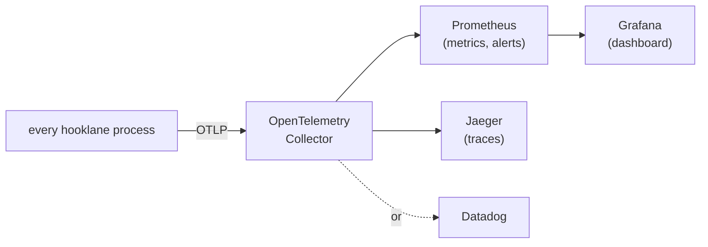

- **Metrics:** end-to-end delivery latency (p50/p95/p99, first attempt vs retried), outcomes, first-attempt success rate, Kafka consumer lag, outbox age, retry backlog, dead deliveries, open circuit breakers, API latency, outbound attempt duration.
- **Traces:** one trace follows an event from the API request, through the outbox and the relay, across Kafka, into the worker and out through the HTTP call. The trace id is stored on the outbox row and carried as a Kafka header.
- **Logs:** structured JSON with `tenant_id`, `event_id`, `delivery_id`, `endpoint_id`. Payloads, secrets and API keys are never logged.
- **SLO:** 99% of events to healthy endpoints delivered within 60 seconds, measured on first attempts.
- **Alerts:** SLO missed, consumer lag growing, outbox stuck, dead deliveries rising, retries overdue, outbound failures spiking across many endpoints.

Details: [docs/OBSERVABILITY.md](docs/OBSERVABILITY.md)

---

## Results

> **These were measured on a laptop, not production hardware.** Apple M1 Pro, with Docker in a VM limited to 6 CPUs and 12 GB. Everything shared that one VM: Postgres, Kafka, the API, four workers, the fake customer endpoints, the observability stack and the load generator itself. Treat the numbers as a floor, and as a way to compare runs.

Each run is verified by a separate tool, [`loadcheck`](crates/loadcheck), which compares what Postgres says should have been delivered against what the fake customer actually received, id by id. "Lost" and "duplicates" are exact counts.

| Test (about 100,000 events, 100 endpoints, 4 workers) | Lost | Duplicates | Delivery latency p50 / p95 / p99 | SLO |
|---|---:|---:|---|---|
| **Steady load**, target 2,000 events/s | **0** | 0 | 0.15 / 0.38 / 0.56 s | met |
| **Spike**: 10× the base rate for 40 s | **0** | 0 | 0.13 / 0.40 / 0.68 s | met |
| **Worker crash**: 3 workers killed with `SIGKILL` mid-run | **0** | 17 | 0.03 / 8.8 / 10.5 s | met |
| **Failing endpoints**: 30% return 5xx, time out or send 429 | **0** | 0 | 0.05 / 0.34 / 0.63 s (healthy endpoints) | met |
| **Database restart** mid-run | **0** | 0 | 0.04 / 0.28 / 0.41 s | met |
| **Postgres mode vs Kafka mode** (10,000 events each) | **0 / 0** | 0 / 0 | p99: 75 ms / 46 ms | met |

Also measured: scaling workers 4 → 8 → 2 during a run (0 lost, 0 duplicates), and Kubernetes autoscaling 1 → 11 → 1 workers on lag (77,634 of 77,634 delivered).

**Sustained throughput on this machine: about 1,785 events per second.**

What the numbers mean:

- **The 17 duplicates are expected.** When a worker is killed mid-request, nobody knows whether the customer received it. After 2 minutes the delivery is sent again. That is the at-least-once trade-off, and it is why `webhook-id` stays the same on every retry: a receiver that dedupes on it sees each event once.
- **The slow tail in the crash test** (p95 of 8.8 s) is Kafka waiting 10 seconds to decide a killed worker is really gone before giving its partitions to another.
- **Failing endpoints did not slow healthy ones.** With 30% of endpoints broken, the other 70% still got every event with a p99 of 0.63 s.
- **During the database restart**, the API answered `503` to 59 requests. Those were never accepted, so they are not lost; the sender retries them.

**What broke along the way.** The first steady run rejected 4,221 requests. The API had a pool of 20 database connections, and since every ingest is one database transaction, the pool size was capping throughput. Raising it to 64 (and lifting the container's open-file limit) took the run from 1,332 to 1,785 events/s with zero rejections. The system is now limited by CPU, with Postgres the largest consumer at roughly four commits per event. Turning off `synchronous_commit` would make it faster, and was deliberately not done, because a `202` has to mean the event is safely on disk.

**Not run:** the Postgres-vs-Kafka comparison at the full 100,000 size, and the 1,000,000-event run. The test machine ran out of disk space.

Full write-up and every report: [docs/RESULTS.md](docs/RESULTS.md), [docs/results/](docs/results)

---

## Running it

### With Docker (everything)

| Command | Does |
|---|---|
| `make up` | Build and start the whole stack. `WORKERS=4 make up` sets the worker count. |
| `make demo` | Start the stack, create endpoints, send 100 events, print a summary. |
| `make logs` | Tail every service. |
| `make down` | Stop everything and delete its data. |
| `QUEUE_MODE=postgres make up` | Run the simpler Postgres-only queue: no relay, no Kafka. |

### Load and chaos tests

| Command | Does |
|---|---|
| `make load` | Steady load, about 100k events, with a verification report. |
| `make load-spike` | 10× spike; checks that lag drains. |
| `make chaos-worker` | Kills workers with `SIGKILL` during a run. |
| `make chaos-endpoints` | 30% of endpoints misbehave. |
| `make chaos-db` | Restarts Postgres during a run. |
| `make load-compare` | The same load in both queue modes. |
| `make load-scale` | Scales workers up and down mid-run. |
| `make load-full` | 1,000,000 events. |

Reports are written to `docs/results/`. The load tests need a few GB of free disk and refuse to start with less than 4 GB.

### Kubernetes (local, with autoscaling)

```bash
brew install kind kubectl
make k8s-up      # kind cluster + KEDA + metrics-server + Hooklane
make k8s-demo    # sends a burst; prints worker count and lag every 5 s
make k8s-down
```

### Configuration

Every setting is an environment variable. The full list with defaults is in [`.env.example`](.env.example). The ones that matter most:

| Variable | Default | Meaning |
|---|---|---|
| `QUEUE_MODE` | `kafka` | `kafka` or `postgres` |
| `SECRET_ENCRYPTION_KEY` | generated by `make up` | Encrypts endpoint signing secrets at rest |
| `RETRY_SCHEDULE_MS` | `5000,300000,...` | Waits before attempts 2 to 8 |
| `ALLOW_PRIVATE_ENDPOINTS` | `false` | Turns the SSRF rules **off**. Only for local Docker networks. Logs a loud warning. |
| `ALLOW_HTTP` | `false` | Allow non-HTTPS endpoint URLs |
| `PER_ENDPOINT_CONCURRENCY` | `1` | 1 preserves per-endpoint ordering |

### Optional: AWS

[`deploy/terraform/`](deploy/terraform) describes a cloud version (VPC with one NAT gateway and a static outbound IP, EKS, RDS) meant to be created for a load test and destroyed straight after. It has been validated with `terraform validate` and **never applied**.

---

## Testing

```bash
make test    # unit tests, then integration tests (starts Postgres and Kafka for you)
make lint    # cargo fmt --check and clippy with warnings as errors
```

Native development needs Rust and cmake: `brew install rustup cmake && rustup default stable`.

- **60 unit tests:** retry schedule and jitter bounds, the classification table, `Retry-After` parsing, the token bucket, every circuit-breaker transition, signing (cross-checked with the official library), every blocked IP range, offset tracking, cursor encoding, secret encryption.
- **34 integration tests** against a real Postgres and a real Kafka broker. Each test gets its own database and its own topic. Most run in **both** queue modes.

Some of the integration tests, in plain words:

| Test | What it proves |
|---|---|
| Relay duplicate | The same outbox row is published twice. The customer receives one request. |
| Worker crash | A worker is killed in the middle of an HTTP request. The delivery is recovered and delivered. |
| Idempotency | 20 concurrent requests with the same key produce one event. |
| Dead letter | A failing endpoint gets exactly 8 attempts, then `dead`, then a system event is sent, and that system event failing does not create another. |
| Slow neighbour | With a 3-second endpoint and a fast one on the same partition, the fast one is served in well under 1.5 s. |
| SSRF | A hostname that resolves to a private address is refused at connect time. |
| Tenant isolation | Tenant B gets `404` on every one of tenant A's resources. |
| Pagination | Paging through events while new ones are inserted returns every original row exactly once. |

---

## Project layout

```
crates/hooklane/src/
  main.rs            the CLI: --role, migrate, admin
  config.rs          every setting, as flags and environment variables
  api/               routes, auth, pagination
  db/                all SQL, one file per group of tables
  relay.rs           outbox to Kafka
  scheduler.rs       due retries, reaper, auto-disable, cleanup
  worker/            consume loops, lanes, offset tracking, processing one delivery
  delivery/          signing, ssrf, http, retry, breaker, ratelimit
  queue/             the kafka / postgres queue modes
  telemetry.rs       logs, traces, metrics export
crates/sink/         fake customer endpoints for tests and load runs
crates/loadcheck/    verifies a load run: lost, duplicates, latency
migrations/          the schema
deploy/compose/      Collector, Prometheus, alert rules, Grafana dashboard
deploy/k8s/          kustomize base, kind and cloud overlays
deploy/terraform/    optional AWS version (never applied)
loadtest/            k6 script and the test runner
examples/typescript/ sending events and verifying signatures
docs/                the documents below
```

The code is written to be read by someone new to Rust. Every module starts with a comment saying what it does and why it exists, and every place a guarantee is enforced has a comment saying what would go wrong without it.

### Further reading

| Document | What it is |
|---|---|
| [docs/CODE_TOUR.md](docs/CODE_TOUR.md) | One event followed through the code, then one failure followed to `dead` |
| [docs/DECISIONS.md](docs/DECISIONS.md) | Every decision, the alternatives, and a one-sentence explanation of each |
| [docs/CONCEPTS.md](docs/CONCEPTS.md) | A plain-English glossary: outbox, consumer lag, circuit breaker, SSRF, and 19 more |
| [docs/INTEGRATION.md](docs/INTEGRATION.md) | How an application sends events and how receivers verify them |
| [docs/OBSERVABILITY.md](docs/OBSERVABILITY.md) | Metrics, traces, logs, alerts, and sending them to Datadog |
| [docs/RESULTS.md](docs/RESULTS.md) | Load and chaos test results, and what broke |
| [docs/PROGRESS.md](docs/PROGRESS.md) | The build log |

---

## Limits and non-goals

**Known limits**

- Ordering is best effort: in order on the normal path, but a retried delivery arrives late.
- Worker parallelism is capped at 64 by the partition count.
- A change to an endpoint (new URL, disabled) reaches workers within 30 seconds, because workers cache endpoints.
- In Postgres queue mode, rate limits and circuit breakers are per worker, so they are approximate.
- The local Kubernetes setup does not export telemetry. Dashboards and traces are shown with Docker Compose.
- It has not been run in production or on cloud hardware.

**Out of scope (possible future work)**

Receiving inbound webhooks; a customer-facing portal or any UI; multiple regions; a strict-ordering option; priority lanes; payload transformations; billing or usage limits; long-term data retention and table partitioning.

---

## FAQ

**Can a customer receive the same event twice?**
Rarely, yes. If a worker crashes after sending a request but before recording the result, nobody knows whether it arrived, so it is sent again. Guaranteeing exactly-once delivery to a third party over a network is not possible in general. The standard answer is at-least-once delivery plus deduplication by the receiver, which is why `webhook-id` never changes between retries.

**What happens if Kafka goes down?**
The API keeps accepting events, because it only writes to Postgres. Outbox rows pile up, and the relay publishes them when Kafka is back. Nothing is lost; deliveries are delayed.

**What happens if Postgres goes down?**
The API answers `503` (it does not crash), so senders retry. The relay, scheduler and workers retry their connections with backoff and resume. In the restart test, zero accepted events were lost.

**Why is the breaker state not shared between workers?**
It does not need to be. Kafka gives each endpoint to exactly one worker at a time. If that worker dies, the next owner starts with a fresh breaker, and the worst case is a few extra failed attempts.

**Why not use an existing service like Svix or Convoy?**
For a real product you probably should. This project exists to show how such a system is built and to measure it honestly.

**Is it fast?**
About 1,785 events per second sustained on a 6-CPU laptop VM that was also running the database, the broker, the load generator and the monitoring stack. It has not been measured on real hardware.

---

## License

MIT. See [LICENSE](LICENSE).
